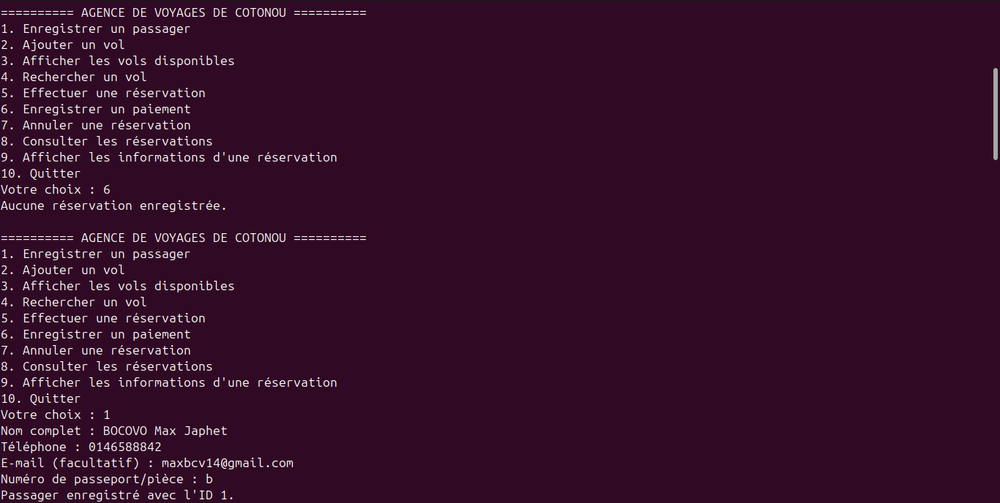
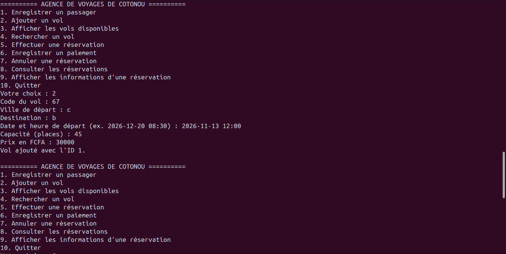

# Agence de voyages de Cotonou

Ce projet est une application console écrite en C++17. Elle aide une agence de voyages à gérer les passagers, les vols, les réservations et les paiements.

## Démarrer l’application

Depuis le dossier du projet, compile et lance le programme avec ces deux commandes :

```bash
g++ -std=c++17 -Wall -Wextra -Wpedantic main.cpp -o agence_voyages
./agence_voyages
```

## Ce que permet le programme

Le menu de l’application propose les actions suivantes :

1. **Enregistrer un passager** : saisir son nom, son téléphone, sa pièce d’identité et, facultativement, son adresse e-mail.
2. **Ajouter un vol** : renseigner son code, son origine, sa destination, sa date et heure de départ, sa capacité et son prix en FCFA.
3. **Afficher les vols disponibles** : consulter les vols actifs et le nombre de places restantes.
4. **Rechercher un vol** : chercher par code, ville ou date.
5. **Effectuer une réservation** : associer un passager à un vol et créer une réservation en attente de paiement.
6. **Enregistrer un paiement** : saisir le mode de règlement et confirmer la réservation.
7. **Annuler une réservation** : annuler une réservation et libérer sa place.
8. **Consulter les réservations** : afficher la liste des réservations et leur statut.
9. **Afficher le détail d’une réservation** : consulter les informations d’une réservation choisie.
10. **Quitter** : fermer l’application.

## Règles de gestion

- Un passager doit être enregistré avant de pouvoir réserver un vol.
- Chaque réservation est associée à un seul passager et à un seul vol.
- Un passager ne peut pas avoir deux réservations actives pour le même vol. Une réservation annulée ne bloque pas une nouvelle demande.
- La capacité est contrôlée lors de la réservation puis au moment du paiement, afin d’éviter de confirmer plus de places que le vol n’en possède.
- La place est considérée comme occupée après paiement et confirmation.
- Une réservation annulée ne peut pas être payée ; son annulation libère la place.
- Le paiement est simulé. Aucun service bancaire n’est connecté et le programme ne calcule pas de remboursement.

## Analyse et modélisation

### Préambule

L’objectif est de concevoir un outil simple pour une agence de voyages située à Cotonou. L’application suit les principales étapes d’un voyage : enregistrer les personnes, proposer des vols, créer des réservations et suivre leur paiement ou leur annulation.

### 1. Quelles sont les classes nécessaires ?

- **Passager** : décrit la personne qui souhaite voyager.
- **Vol** : décrit un trajet aérien proposé par l’agence.
- **Réservation** : relie un passager au vol choisi et conserve l’état de la demande.
- **Paiement** : conserve les détails du règlement d’une réservation.
- **AgenceVoyages** : organise les données et les opérations de gestion.
- **StatutReservation** : énumération des états possibles : `EN_ATTENTE`, `CONFIRMEE` et `ANNULEE`.

### 2. Quels sont les attributs et les méthodes de chaque classe ?

- **Passager** — Attributs : identifiant, nom, téléphone, e-mail et numéro de pièce d’identité. La classe représente l’identité et les coordonnées du voyageur.
- **Vol** — Attributs : identifiant, code, origine, destination, date et heure de départ, capacité, tarif et état actif. Ces informations décrivent le trajet et permettent de contrôler les places.
- **Réservation** — Attributs : identifiant, identifiant du passager, identifiant du vol, date de création, statut et date de paiement éventuelle. Méthodes principales : confirmer et annuler.
- **Paiement** — Attributs : réservation concernée, montant, mode de paiement et date du règlement.
- **AgenceVoyages** — Attributs : collections de passagers, de vols, de réservations et de paiements. Opérations : enregistrer un passager, ajouter et rechercher un vol, créer une réservation, accepter un paiement, annuler et consulter les réservations.

### 3. Quelles relations existent entre ces classes ?

- Un passager peut effectuer plusieurs réservations, tandis que chaque réservation désigne un seul passager.
- Un vol peut être concerné par plusieurs réservations, tandis que chaque réservation porte sur un seul vol.
- Une réservation peut être sans paiement ou être associée à un paiement.
- L’agence gère les passagers, les vols et les réservations.
- Le statut d’une réservation appartient à l’énumération `StatutReservation`.

### 4. Quelles sont les multiplicités ?

- **Passager — Réservation** : `1` passager par réservation ; `0..*` réservations possibles pour un passager.
- **Vol — Réservation** : `1` vol par réservation ; `0..*` réservations possibles pour un vol.
- **Réservation — Paiement** : `1` réservation par paiement ; `0..1` paiement pour une réservation.
- **AgenceVoyages — Passager** : une agence gère `0..*` passagers.
- **AgenceVoyages — Vol** : une agence gère `0..*` vols.
- **AgenceVoyages — Réservation** : une agence gère `0..*` réservations.

### 5. Diagramme de classes UML

Le diagramme représente les classes et les relations décrites ci-dessus. Deux présentations sont disponibles : [diagramme UML principal](docs/diagramme-classes.png) et [variante graphique](docs/diagramme-classes-variante.png). Les sources [PlantUML modifiable](docs/diagramme-classes.puml) [PlantUML variante modifiable](docs/diagramme-classes-variante.puml) est également fournie.

Dans le fonctionnement retenu, une réservation attend le paiement. Une fois le paiement enregistré, son statut devient « confirmée » et la place est comptée comme occupée. Une annulation libère la place. Les règles détaillées de remboursement n’étant pas précisées dans le sujet, elles ne sont pas implémentées.

## Captures d’écran

Les captures suivantes illustrent deux actions dans le terminal :

### Enregistrement d’un passager



### Ajout d’un vol



## Organisation des fichiers

- `main.cpp` : code source de l’application.
- `docs/diagramme-classes.png` : diagramme UML principal.
- `docs/diagramme-classes-variante.png` : deuxième présentation du diagramme.
- `docs/diagramme-classes.puml` : source UML modifiable.
- `docs/capture-enregistrement-passager.png` et `docs/capture-ajout-vol.png` : captures de l’application.

## Limite actuelle

Les informations sont conservées en mémoire pendant l’exécution. Elles ne sont pas sauvegardées lorsque l’application se ferme.
